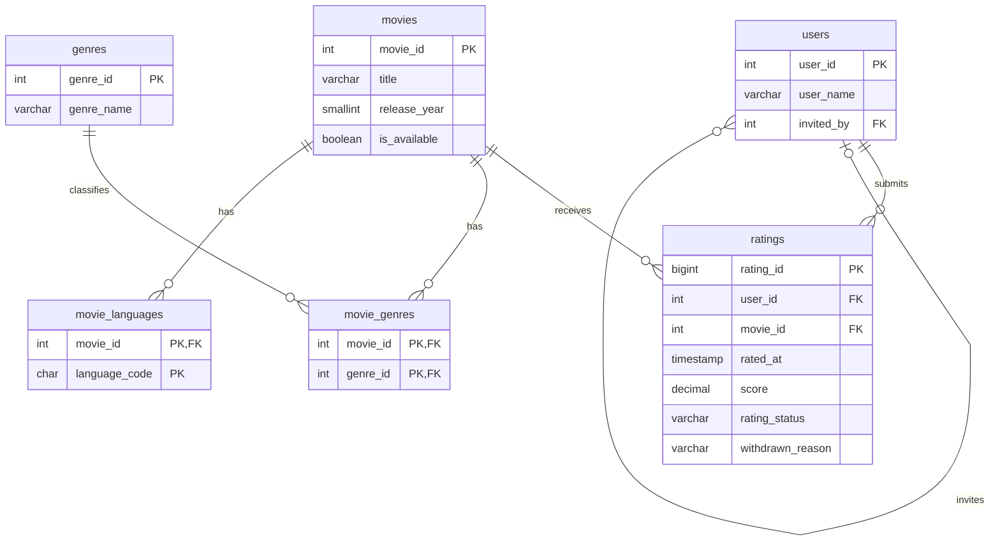

# Movie/TV Ratings Analysis

SQL analysis of movie ratings, spam withdrawals, and changes in activity over time.

## About the project

This project looks at a movie ratings platform. I wanted to find out which
movies get rated, which ratings get removed for spam, and whether that
problem changes over time. The data includes users, movies, ratings,
genres, and the links between them.

I started by filtering ratings and checking missing values. I then compared
movies, connected their names and genres, and found movies with no ratings.
The last set of queries looks at rankings, changes between ratings, and
monthly spam rates. A spam failure means a rating marked withdrawn with
the reason `Spam detected`.

## Database

Units 3–6 use the supplied EX603 dataset in `ex603_data`. It has 30 users,
15 movies, 200 ratings, 5 genres, 25 movie-genre links, and 23 language
links. The supplied [movies.sql](data/movies.sql) creates and fills all
six tables. Its user names and email addresses are synthetic examples.

| Table | What it stores |
| --- | --- |
| users | Reviewer names, signup dates, and countries |
| movies | Titles, release years, countries, and availability |
| ratings | Scores, dates, review status, and withdrawal reasons |
| genres | Genre names and descriptions |
| movie_genres | Links between movies and genres |
| movie_languages | Languages listed for each movie |



The diagram shows the main fields used in the analysis. The full fields
and constraints are in the supplied SQL file. The earlier Unit 2 design
is saved separately in [schema](schema/), with its [original ERD](schema/erd.png).
That design uses one current rating per user and movie. The supplied
dataset keeps rating events and allows repeat user/movie pairs.

## Query catalogue

### Units 1 and 2

| Work | Question | File |
| --- | --- | --- |
| Unit 1 | What does the movie ratings platform need to store? | [Analysis](analysis/unit1.md) |
| Unit 2 | How can keys and constraints keep the original design consistent? | [Schema SQL](schema/schema.sql), [analysis](analysis/unit2.md) |

### Unit 3

| Queries | Question | SQL |
| --- | --- | --- |
| 3.1 | Which movies and ratings match the selected years, scores, statuses, and missing values? | [q3_1](queries/unit3/q3_1.sql) |
| 3.2 | How do missing values and a misplaced alias change a query? | [q3_2](queries/unit3/q3_2.sql) |
| 3.3 | Which users have no ratings withdrawn for spam? | [q3_3](queries/unit3/q3_3.sql) |

### Unit 4

| Queries | Question | SQL |
| --- | --- | --- |
| 4.1 | How do scores and counts compare across movies and countries? | [q4_1](queries/unit4/q4_1.sql) |
| 4.2 | What share of ratings were withdrawn for spam? | [q4_2](queries/unit4/q4_2.sql) |

### Unit 5

| Queries | Question | SQL |
| --- | --- | --- |
| 5.1 | Who rated each movie, and which movies share genres or release years? | [q5_1](queries/unit5/q5_1.sql) |
| 5.2 | Which movies disappear from an inner join because they have no ratings? | [q5_2](queries/unit5/q5_2.sql) |
| 5.3 | How many movie/genre pairs are possible, and how does PostgreSQL plan the joins? | [q5_3](queries/unit5/q5_3.sql) |

### Unit 6

| Queries | Question | SQL |
| --- | --- | --- |
| 6.1 | How do scores compare with movie averages, and how are tied movies ranked? | [q6_1](queries/unit6/q6_1.sql) |
| 6.2 | How do scores and counts change over time, and where are the gaps? | [q6_2](queries/unit6/q6_2.sql) |
| 6.3 | What are each movie's top ratings, and how does spam change each month? | [q6_3](queries/unit6/q6_3.sql) |

## SQL techniques

- CTEs let me calculate a result and filter it in the next step, including window results.
- Conditional counts let me compare spam withdrawals with all ratings using the same denominator.
- Outer joins keep movies with zero ratings in the report.
- Window functions keep each rating visible while adding averages, ranks, and previous scores.
- EXPLAIN showed a hash join, indexed movie lookups, and a final sort. It helped me identify steps to check as the data grows.

## Findings and next steps

- Title_02 and Title_03 account for 5 of 12 spam withdrawals. I would review the accounts behind those ratings for repeat submissions. [Unit 4](analysis/unit4-finding.md), [Unit 5](analysis/unit5-finding.md)
- Movies 14 and 15 have zero ratings. I would check page visits and test their rating forms. [Unit 5 analysis](analysis/unit5.md)
- Monthly spam rates vary. January has 2 of 21 ratings withdrawn for spam, or 9.52%. December has 2 of 16, or 12.50%, after two months with none. I would review the December accounts and keep tracking counts alongside rates. [Unit 6 findings](analysis/unit6-finding.md)

## Limitations

This is a small synthetic dataset. A month with only 11 ratings can have
a large rate change from two spam ratings. It also has no page visits or
data-import logs to explain inactivity. Those records would help me check
whether a gap came from a real drop in activity or missing data.

## Video presentation

Video link will be added after recording.

## How to run

Install PostgreSQL and its command-line tools, then download this repository
and open a terminal in its folder. Use your configured PostgreSQL login.
With PostgreSQL installed, run these commands from the repository folder
to create a database, load the supplied tables and data, and run a query:

For a new database, run:

```sh
createdb ex603_data
psql -d ex603_data -v ON_ERROR_STOP=1 -f data/movies.sql
psql -d ex603_data -v ON_ERROR_STOP=1 -f queries/unit6/q6_1.sql
```

If `ex603_data` already exists, skip `createdb`. Loading `movies.sql` drops
and recreates its six tables, so use a separate database if you have data
to keep. Once loaded, run any query file from Units 3–6 by changing the
last path. In pgAdmin, open a Query Tool connected to `ex603_data`, open
the SQL file, and execute it.

The Unit 2 schema belongs in its own database:

```sh
createdb movie_ratings
psql -d movie_ratings -v ON_ERROR_STOP=1 -f schema/schema.sql
```

The intentional error example in Unit 3 is saved inside a block comment.
It can be selected and run separately to reproduce the error. Query
screenshots are in [screenshots](screenshots/), and the explanations and
recommendations are in [analysis](analysis/).
and recreates its six tables. Change the final file path to run another
query from Units 3–6.
